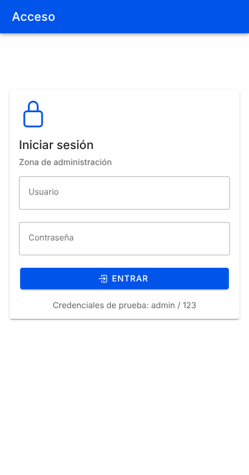
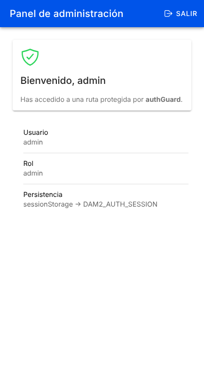

# Laboratorio DI (0488) — Control de acceso con Ionic, Angular Standalone y Functional Guards

App Ionic 8 + Angular 20 (standalone) con:

- `/login` pública con formulario reactivo (credenciales de prueba **admin / 123**).
- `/admin` protegida por `authGuard` (`CanActivateFn`), que redirige a `/login?returnUrl=/admin` con un `UrlTree`.
- Sesión en Signals (`AuthService`) persistida en `sessionStorage` (clave `DAM2_AUTH_SESSION`), así que sobrevive a un F5.

## Ejecutar

```bash
npm install
npm start          # o: ionic serve
```

Abre http://localhost:8100

## Estructura (lo que pide la guía)

```
src/
├── main.ts                          # bootstrap: provideIonicAngular + provideRouter
├── styles.scss                      # CSS base de Ionic (equivale a global.scss)
└── app/
    ├── app.component.ts             # <ion-app><ion-router-outlet>
    ├── app.routes.ts                # rutas lazy + canActivate: [authGuard]   (CE 1.c, 1.d)
    ├── core/
    │   ├── services/auth.service.ts # Signals + sessionStorage                (CE 1.e)
    │   └── guards/auth.guard.ts     # Functional Guard → true | UrlTree        (CE 1.d)
    └── pages/
        ├── login/                   # formulario reactivo + returnUrl
        └── admin/                   # vista protegida + logout
```

Separación de responsabilidades (CE 1.b): el estado vive en el servicio, la decisión de acceso en el guard y las páginas solo leen el Signal y llaman a `login()` / `logout()`.

## Pruebas realizadas

| # | Acción | Resultado |
|---|--------|-----------|
| 1 | Escribir `/admin` sin sesión | Redirige a `/login?returnUrl=%2Fadmin` |
| 2 | Credenciales incorrectas | Se queda en login y muestra "Usuario o contraseña incorrectos." |
| 3 | `admin` / `123` | Navega a `/admin` (el `returnUrl`) |
| 4 | F5 en `/admin` | Sigue en `/admin`; la sesión está en `sessionStorage` |
| 5 | Ir a `/login` con sesión | Redirige a `/admin` |
| 6 | Pulsar **Salir** | Vuelve a `/login` y borra `DAM2_AUTH_SESSION` |
| 7 | Escribir `/admin` tras salir | Redirige otra vez a login |

Sin errores en consola.

## Cambios respecto al texto de la guía

- `signal<UserSession null |>` → `signal<UserSession | null>` (error de sintaxis del PDF).
- El generador de guards usa `--implements=CanActivate`, no `--type=canActivate`.
- `returnUrl` solo acepta rutas internas (empiezan por `/`) para evitar redirecciones abiertas.

## Nota de seguridad

El guard solo controla la navegación en el cliente: cualquiera puede crear la clave `DAM2_AUTH_SESSION` desde DevTools y entrar en `/admin`. En una app real la protección de los datos debe hacerse en el backend (por ejemplo, con un JWT validado por el servidor).

 
